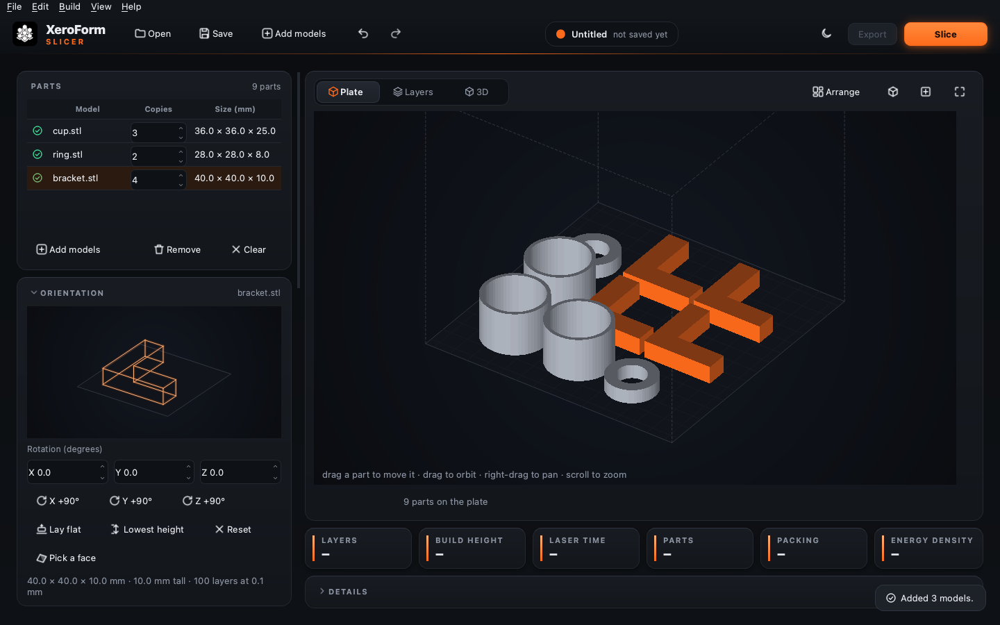
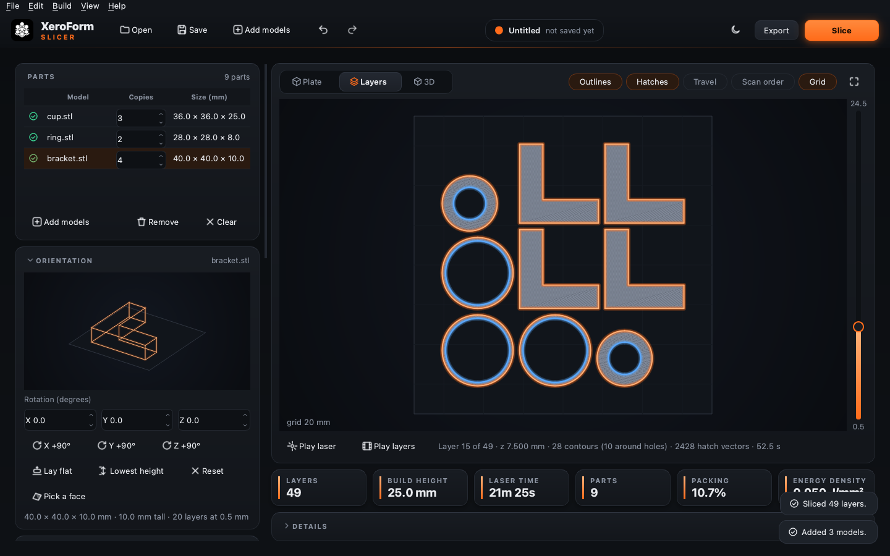

# XeroForm Slicer

[](https://github.com/oumarknt31/xeroform-slicer/actions/workflows/tests.yml)
[](https://github.com/oumarknt31/xeroform-slicer/releases/latest)
[](LICENSE)

XeroForm Slicer is the open-source slicer for the XeroForm low-cost SLS
(selective laser sintering) 3D printer. It turns 3D models (STL, OBJ, PLY or
3MF) into laser tool-paths and writes them to a machine file:

```text
load model  ->  slice into layers  ->  hatch (outlines + laser fill)  ->  export (.cli)
```

It comes as a desktop app for macOS, Windows and Linux, a command-line tool and
a Python library, built on the open-source [PySLM](https://pyslm.readthedocs.io)
slicing library.



## Install the app

Each command below installs or updates XeroForm. No Python is needed and no
security prompt appears.

```bash
# Mac (Terminal)
curl -fsSL https://raw.githubusercontent.com/oumarknt31/xeroform-slicer/main/install/install-mac.sh | sh
# Windows (PowerShell)
irm https://raw.githubusercontent.com/oumarknt31/xeroform-slicer/main/install/install-windows.ps1 | iex
# Linux (x86-64)
curl -fsSL https://raw.githubusercontent.com/oumarknt31/xeroform-slicer/main/install/install-linux.sh | sh
```

The installer picks the right build for your computer, checks the download
against the release's `SHA256SUMS.txt`, and waits for you to quit a running
XeroForm instead of closing it. You can also download the app manually from the
[latest release](https://github.com/oumarknt31/xeroform-slicer/releases/latest);
its notes explain the one-time security prompt for manual downloads.

## Use the desktop app

Start it from Applications, the Start menu or your app menu, or run
`xeroform-gui` (optionally with model or `.xeroform` project files).

- **Parts**: add models, or drop them on the window, and set copies per model. A
  warning icon marks a model with repairs or a likely units problem; hover it
  for details.
- **Plate**: every copy of every part in 3D, where it will be printed. Parts are
  packed automatically as you add them. Drag a part to move it (it then stays
  where you put it, and new copies are packed around it); *Arrange* packs
  everything again. Parts too close together or to the walls turn red, with the
  reason under the view. The angled and top-view buttons set the camera; drag
  empty space to orbit, right-drag to pan, scroll to zoom.
- **Orientation**: turn the selected part with X/Y/Z angles or ±90° buttons.
  *Lay flat* rests it on its largest flat face (click again for the next face),
  *Pick a face* lets you click the face to rest it on in the plate view, and
  *Lowest height* turns it for the fewest layers, which is the fastest and
  cheapest way to print it. The size and layer count update as you turn it.
- **Part settings**: give the selected part its own laser power, speed and hatch
  spacing, for example more power for a thick part in a build of thin ones.
  Parts with their own settings have a laser mark in the list.
- **Settings**: grouped in collapsible cards, each with a tooltip. *Reset to
  defaults* restores them. The build volume starts as a 150 mm placeholder until
  the machine is known.
- **Undo and redo** (⌘Z / Ctrl+Z, ⇧⌘Z / Ctrl+Shift+Z) for every change to the
  parts, their places and the settings.
- **Slice** (⌘R / Ctrl+R): runs in the background with progress and Cancel.
  Tiles show layers, build height, laser time, parts, packing density and energy
  density; the full report is under *Details*.
- **Views** of the slice, with a vertical layer slider (←/→, PgUp/PgDn ±10,
  Home/End):
  - *Layers*: one layer from above with outlines, hatches, travel moves, scan
    order and a mm grid. **Play laser** (Space) animates the laser tracing the
    layer in scan order.
  - *3D*: the sliced contours stacked in 3D. Drag to orbit, scroll to zoom.
  - **Play layers** runs through the build like a flip-book.
- **Out of date**: if you change a part or setting after slicing, a banner says
  so and exporting stays blocked until you slice again.
- **Projects** (`.xeroform`, JSON): save the parts, their orientation and own
  settings, every setting, and where parts were placed by hand. Model paths are
  stored relative to the project file.
- **Export** (⌘E / Ctrl+E) writes the `.cli` file. Nothing is written before
  that.
- **Updates**: once a day XeroForm asks GitHub whether a newer version is out
  and, if so, shows *Update to …* in the header with the command that updates
  it. Turn this off under *Help*, or check by hand there.
- **Look**: dark graphite with a laser-orange accent, or a soft-grey light mode.
  The moon/sun button in the header switches between dark, light and system.

The window remembers its size, theme, last folder and last settings. Unexpected
errors show their details and go to a log file (*Help ▸ Show Log File*).



## Use the command line

The `xeroform` command slices without the app. The examples write `model.cli`
from `model.stl`:

```bash
xeroform model.stl -o model.cli --layer 0.1 --hatch-distance 0.2

# also write an interactive layer preview to open in a browser
xeroform model.stl -o model.cli --preview model.html

# turn a model for the fewest layers, or by fixed angles (degrees about X, Y, Z)
xeroform model.stl -o model.cli --orient lowest
xeroform model.stl -o model.cli --rotate 90 0 0

# a model drawn in inches, checked against the machine's build volume
xeroform model.stl -o model.cli --scale 25.4 --build-volume 150 150 150

# pack several parts and copies into one build
xeroform bracket.stl gear.stl --copies 5 -o build.cli --build-volume 150 150 150

# laser settings in W and mm/s (the defaults are placeholders)
xeroform model.stl -o model.cli --hatch-power 5 --hatch-speed 500 \
    --contour-power 4 --contour-speed 400 --jump-speed 2000

# a project saved in the app, with its own settings, parts' settings and layout
xeroform build.xeroform -o build.cli
```

Run `xeroform --help` for every option and `xeroform --version` for the version. `python -m xeroform` works too.

### Model checks

Before slicing, XeroForm checks each model:

- **Repairs** what is safe to fix automatically: zero-area or duplicate
  triangles, small holes in the surface and inside-out faces. It lists what it
  changed.
- **Refuses** models it can't slice correctly, such as large gaps in the surface,
  no volume or unreadable files, with a message saying what to do.
- **Combines** shells that touch or overlap (a model built from several solids):
  they print as one solid, while a cavity modelled as an inside-out shell stays
  hollow.
- **Warns** when the size suggests wrong units. STL files carry no units, so
  inch CAD parts arrive 25.4 times too small; fix that with `--scale 25.4`.
- **Centres** the part on the plate (x = y = 0 is the middle, z = 0 the bottom)
  and, with `--build-volume X Y Z`, refuses parts that don't fit.

### Packing several parts

Give several files or `--copies N`, together with `--build-volume`, and
XeroForm packs everything into one build. SLS needs no supports, so parts can
sit side by side and stacked. The packer:

- keeps the build as low as possible, because every layer costs a powder
  recoat;
- packs by the parts' real shapes, so a small part can sit inside a ring, in a
  cup or in the corner of a bracket. Every part can still be lifted straight
  out, top one first, so nothing gets trapped. When plain boxes pack lower
  (rectangular parts), it uses those instead;
- keeps `--part-spacing` (3 mm by default) between parts and from the walls;
- may turn parts about Z to fit (`--no-rotate` turns this off), but never tips
  them over;
- centres the packed block on the plate, where the powder bed is most even.

The run prints the build height and packing density (part volume / plate area ×
height), and names the parts that don't fit.

### Scan order

`--scan-order` sets the order of the fill lines. PySLM's own order (`raster`)
points every line the same way, so the laser jumps back across the part with
the beam off after each one.

| Mode | What it does | Laser-off travel vs `raster` on test parts |
|---|---|---|
| `nearest` (default) | continues with the closest unscanned line | 94–99% less |
| `meander` | zig-zags line by line across the layer | 72–99% less, worst with holes |
| `raster` | every line in the same direction | baseline |

On the test parts this cut the estimated laser time by 17–23% at a 2000 mm/s
jump speed. It matters more on a slow gantry machine.

### Output

Every run prints the estimated laser time (scanning only, without recoating or
heating) and the fill energy density `P / (v × h)` in J/mm², the main number to
tune per powder. Laser settings are stored in physical units and converted by
each exporter; standard ASCII CLI has no field for them.

## Use it from Python

The same pipeline is available as a library:

```python
from xeroform import SliceConfig, slice_file, write_preview

layers = slice_file("model.stl", "model.cli",
                    SliceConfig(layer_thickness=0.1, hatch_distance=0.2))
print(len(layers), "layers")
write_preview(layers, "model.html")
```

## How it's built

- **Standalone engine.** The slicer is a library; the command line and the
  desktop app both call it.
- **One boundary with PySLM.** PySLM's objects become XeroForm's own `Layer`
  model in exactly one place (`slicing.py`), so swapping the slicing backend
  touches only that file.
- **Pluggable exporters.** Output goes through the `Exporter` interface, so the
  printer's final file format (a `.cli` dialect, binary CLI or G-code) is one
  new file in `export/`.

```text
src/xeroform/
  part.py         load, repair, check and place a mesh
  orient.py       rotations, lay flat, lowest build height
  slicing.py      part -> layers (the only PySLM -> XeroForm translation)
  hatching.py     hatch and contour settings
  scan_order.py   order and direction of fill lines
  nesting.py      pack several parts into one build
  layers.py       the Layer / Contour / Hatch / ScanParams model
  laser.py        laser settings, path lengths, time estimate
  config.py       SliceConfig
  pipeline.py     runs the stages
  export/         Exporter interface and the ASCII .cli writer
  preview.py      interactive HTML layer viewer
  summary.py      the text report shared by the command line and the app
  project.py      .xeroform project files
  __main__.py     command line
  gui/            desktop app (window, panels, views, theme, background tasks)
    assets/       XeroForm logo as SVG
tests/            unit, pipeline and headless GUI tests
tools/            build_logo.py (logo SVGs), make_icons.py (app icons)
docs/             README screenshots and the original logo artwork
packaging/        PyInstaller recipe and release notes
install/          one-line installers
.github/          tests, release builds, installer tests, Dependabot, issue template
```

## Development

Install from source with the test and app extras:

```bash
python -m venv .venv && source .venv/bin/activate   # Windows: .venv\Scripts\activate
pip install -e ".[dev,gui]"
pytest -q                                         # GUI tests need QT_QPA_PLATFORM=offscreen on a server
ruff check src tests tools
```

The package that provides `import pyslm` on PyPI is **PythonSLM**; it installs
automatically.

To publish a release, set `__version__` in `src/xeroform/__init__.py`, add an
entry to [CHANGELOG.md](CHANGELOG.md), then push a tag:

```bash
git tag v0.3.0 && git push origin v0.3.0
```

GitHub Actions builds the app for macOS (Apple Silicon and Intel), Windows and
Linux, checks each build starts and slices, publishes the release with
`SHA256SUMS.txt`, and then tests every installer against it. Every push to
`main` runs the tests on all three systems.

## Status

Done: part orientation, slicing with orientation-correct contours, per-layer hatch rotation,
laser settings and time estimate, mesh checks and repairs, scan order, nesting,
HTML preview, command line, desktop app, packaged releases and installers.

Open:

- **Output format.** The `.cli` file is structurally valid, but the machine's
  controller and firmware aren't chosen yet, so the units, header keywords and
  direction-flag handling still need confirming. All of that lives in
  `export/cli_ascii.py`.
- **Laser values.** Power, speed and build volume are placeholders until the
  laser and machine are specified; tuning for nylon follows.
- **Code signing.** Signing would remove the security prompt for manual
  downloads (the installers already avoid it).

`trimesh` is capped below version 6 because PySLM 0.6 calls `Path.to_planar`,
which trimesh has deprecated.

## Security

See [SECURITY.md](SECURITY.md) to report a vulnerability privately.

## License

XeroForm Slicer is released under the [MIT License](LICENSE). The packaged apps
include third-party libraries under their own licenses; see
[THIRD_PARTY_NOTICES.md](THIRD_PARTY_NOTICES.md).
